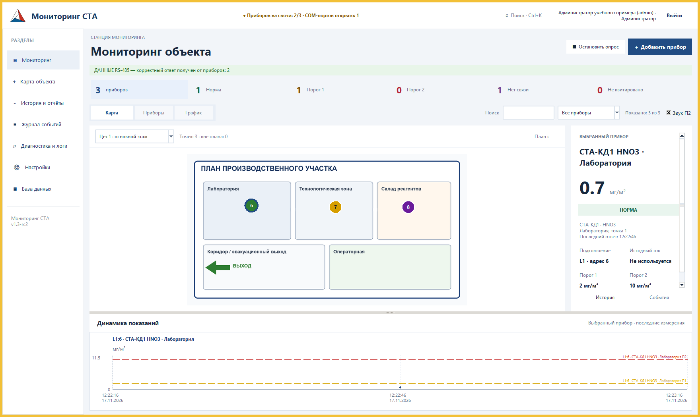
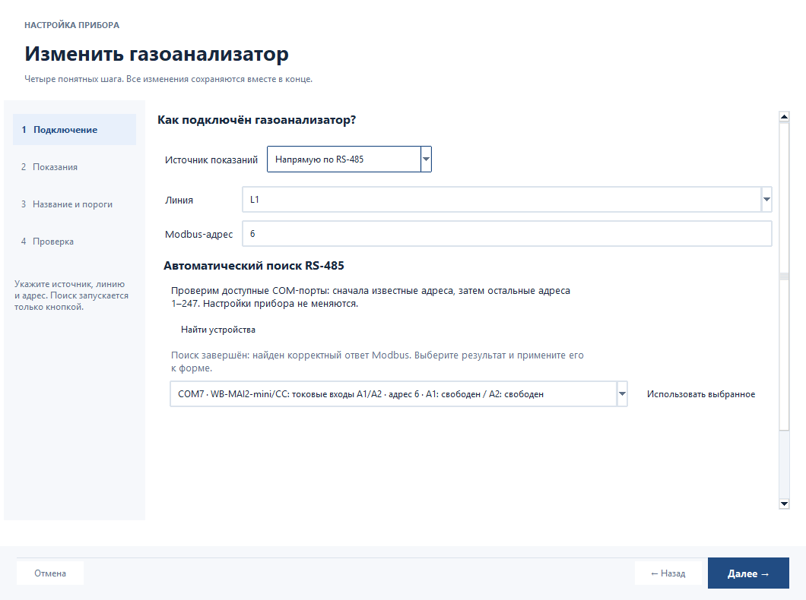

# Мониторинг СТА

Готовое приложение для Windows: мониторинг газоанализаторов СТА по USB–RS-485, тревоги, карта объекта, архив, отчёты и диагностика.

## Скачать программу

[Открыть страницу выпусков и обновлений](https://github.com/justGoty/sta-software-releases/releases)

### Доступные версии

- [v1.2 — стабильная версия](https://github.com/justGoty/sta-software-releases/releases/tag/v1.2).
- [v1.3-rc2 — предварительная версия](https://github.com/justGoty/sta-software-releases/releases/tag/v1.3-rc2): обновлённый мониторинг с планом объекта и мастер подключения. Новый EXE пока не проверен с физическим газоанализатором; сначала проверьте его на отдельной копии.

[Скачать комплект v1.3-rc2 для Windows x64](https://github.com/justGoty/sta-software-releases/releases/download/v1.3-rc2/STA-software-v1.3-rc2-Windows-x64.zip) · [Руководство PDF](https://github.com/justGoty/sta-software-releases/releases/download/v1.3-rc2/RE_Monitoring_STA_v1.3-rc2.pdf)

В каждом комплекте: единый EXE для станции и сетевого рабочего места, руководство по эксплуатации PDF, краткая инструкция на русском, ссылка на обновления, лицензии сторонних компонентов и контрольные суммы SHA-256. Python устанавливать не нужно. Исходный код и данные объектов здесь не публикуются.

## Перед запуском

1. Скачайте ZIP из раздела **Assets** нужного выпуска и прочитайте описание версии. Автоматические архивы GitHub «Source code» содержат материалы этой страницы, а не программу и не её исходники.
2. Сверьте SHA-256 с контрольной суммой выпуска и распакуйте комплект в отдельную локальную папку с правом записи. Не запускайте рабочую станцию прямо с флешки или внутри ZIP.
3. Откройте `START_HERE_RU.txt` и РЭ. На станции выберите соответствующую роль компьютера; для сетевого рабочего места используется тот же EXE.
4. До ввода в эксплуатацию замените временные пароли и проверьте связь, показания, тревоги и архив с реальным оборудованием по регламенту объекта.

Целевые системы — Windows 10/11 x64. Проверки конкретной версии и известные ограничения приведены в описании выпуска. Цифровая подпись издателя пока отсутствует. При предупреждении защитных средств обратитесь к ответственному администратору; не отключайте защиту Windows.

## Обновление

Закройте приложение в согласованное время, создайте полную защищённую резервную копию рабочей папки и следуйте разделу обновления в РЭ. Не заменяйте настройки, базы, карты и журналы чужими файлами. Сетевой API предназначен только для доверенной локальной сети; не открывайте его в Интернет.

ПО не заменяет приборную сигнализацию и правила безопасности объекта. Для технической поддержки используйте контакты вашего поставщика; не публикуйте пароли, ключи, конфигурацию объекта и необезличенные журналы в открытом репозитории.

## Интерфейс v1.3-rc2

Снимки учебного примера, не данные действующего объекта.

